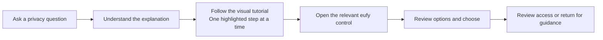

# CCTV Privacy — Understand, Find, and Control

A DECO7380 university design prototype exploring how home CCTV users can better understand their camera data and find the controls they need.

Our project connects a **third-party privacy guidance platform** with **proposed improvements to the eufy experience**. Users can ask a privacy question, learn what it means, and follow a visual tutorial to the relevant setting.

**[Open the prototype](https://yenyong1211.github.io/DECO7380_CCTV/)** · **[Read the full workflow](docs/WORKFLOW.md)**

## Why we are building this

Home cameras can make it difficult to understand where recordings go, who can view them, and what changes when a recording is shared or a permission is removed. Even when a privacy control exists, users may not know where to find it.

We aim to connect privacy information with practical guidance: help people understand their options, locate the right control, and make their own choices.

## Two connected parts

### 1. Third-party privacy guidance platform

The third-party platform is where users ask questions and explore their CCTV privacy profile. Its core design is a **step-by-step tutorial**, rather than an answer that leaves the user to find a setting alone.

For example, a user asks **“Where are my privacy settings?”**. The tutorial shows one interface page at a time, highlights the relevant control with a box and arrow, and guides them through:

**ANN’s Home → Menu → Settings → Privacy**

Tutorials use short instructions, Previous / Next navigation, and a completion summary. Users can replay the guidance, ask another question, or explicitly open the corresponding eufy page.

The platform also includes:

- **Smart Privacy Search:** questions about access, storage, sharing, permissions and privacy information.
- **Privacy Profile:** an overview of the example device and its privacy-related features.
- **My Data Flow:** visual explanations of local storage, optional cloud paths and exported copies.
- **Exposure, User Control and Evidence:** explanations of illustrative research scores and the assumptions behind them.
- **Access review:** an activity overview that connects users to detailed records and controls.

### 2. Proposed improvements to the eufy experience

The eufy-facing prototype retains the familiar interface context and adds explanations and controls around privacy and camera access. **The welcome/login page belongs to this eufy-facing part.**

| Area | What users can explore |
| --- | --- |
| **Privacy Agreement** | An animated explanation of data collection, storage, access and deletion before demo entry |
| **Welcome / demo login** | Entry to the prototype without a real account |
| **ANN’s Home** | Living Room and Front Door camera previews |
| **Privacy guide** | Your data journey; People & access; Keep, share or delete |
| **Privacy settings & policies** | Official document links, app-permission explanations and data rights |
| **Access History** | Who viewed a camera or recording, with date/time selection and expandable visits |
| **Viewing Permissions** | Original view, Hide faces, Hide whole person, or No access for a demonstrated shared viewer |
| **Viewer verification** | A simulated face-match and camera-permission decision for the person requesting access |
| **Supporting screens** | Camera Events, Services, Smart, Shop, Messages and Notifications |

This is a student proposal for improving the eufy experience. It is not an official eufy product or an established commercial partnership.

## The intended user journey



The third-party platform **explains and guides**. The eufy-facing screens are where the user reviews or changes the demonstrated setting. Finishing a tutorial does not automatically change permissions or accept an agreement.

For example, a user could review yesterday’s camera visits, find a shared viewer’s permissions, choose No access, and understand that this affects future viewing without deleting past visits or previously downloaded files.

## Try the current prototype

| Entry | Link |
| --- | --- |
| Third-party privacy platform | [Open prototype](https://yenyong1211.github.io/DECO7380_CCTV/) |
| eufy agreement and welcome | [Open agreement](https://yenyong1211.github.io/DECO7380_CCTV/agreement/) |
| eufy Home | [Open ANN’s Home](https://yenyong1211.github.io/DECO7380_CCTV/prototype/#home) |
| Privacy guide | [Explore privacy](https://yenyong1211.github.io/DECO7380_CCTV/prototype/#privacy) |
| Access History | [Review access](https://yenyong1211.github.io/DECO7380_CCTV/prototype/#events/access) |
| Third-party search implementation | [View the search feature branch](https://github.com/yenyong1211/DECO7380_CCTV/tree/feat/privacy-search-entry) |

The browser may show the optional privacy introduction on the first Home visit. It can be skipped and reopened through **Menu → Settings → Privacy**.

## What is implemented, and what comes next?

The repository contains work across the published `main` branch and feature branches. All of these modules form part of the project.

- **Integrated on main:** the third-party privacy platform, animated agreement, demo welcome entry, eufy interface, privacy guide, access-history and viewing-permission interactions, and viewer-verification demo.
- **Third-party privacy platform:** Smart Search, structured answers, privacy profile, interactive visual exposure factors, people/visibility explanations, branching data flow, evidence disclosures and a demo access timeline. Search uses a curated English question library. Controls and review actions open existing eufy routes; the general eufy entry opens the agreement.
- **Tutorial design to implement:** page-by-page instructions with target boxes and arrows, shared navigation, and clear completion/handoff states. This is the core interaction described in the workflow; it is not yet provided by the existing search-answer interface.

The root opens the third-party privacy platform. The eufy agreement remains available at `agreement/`, and action links retain the existing `prototype/#…` routes. See [WORKFLOW.md](docs/WORKFLOW.md) for complete flows, the first tutorial specification, and integration priorities.

## Demo scope

Camera images, identities and activity are examples. The project does not connect to real cameras, authenticate a real eufy account, or collect face biometrics. The verification interaction is a simulation; current direct camera links can still open illustrated previews without it.

Viewing-permission changes are stored in the current browser. Past access records remain separate from current permissions. Example exposure/control scores are fixed research illustrations, not live security measurements or official certifications. Downloading, deleting real recordings and changing real cloud subscriptions are outside this prototype.

The sample access-history reference date is **21 October 2026**; “yesterday” in the example search content means **20 October 2026**.

## Run locally

Serve the repository through HTTP so JavaScript modules load correctly:

```sh
python3 -m http.server 7380
```

Open `http://localhost:7380/` for the entry page, or `http://localhost:7380/prototype/` for the eufy-facing interface. The root opens the third-party platform; the general eufy entry opens `agreement/`. No build step or API key is required.

## Repository guide

| Path | Contents |
| --- | --- |
| `index.html` | Third-party privacy platform entry |
| `agreement/` | Animated agreement, welcome page and SVG illustrations |
| `prototype/` | eufy-facing interface, privacy content, cameras and verification |
| `prototype/history/` | Access History, sample visits and viewing-permission controls |
| `privacy/` | Third-party search, privacy profile, knowledge library and visualisations |
| `tests/` | Search and destination checks |
| `docs/WORKFLOW.md` | Shared workflow, tutorial specifications and integration notes |

Start with [the workflow](docs/WORKFLOW.md) for the complete project journey, or [the eufy prototype notes](prototype/README.md) for module details.

## Validation

Run all routing/content and agreement checks with Node 22+: `node --test tests/*.test.mjs`. Search deep links preserve local hosting and the `/DECO7380_CCTV/` GitHub Pages prefix. The example Exposure 5/10 and User Control 8/10 scores remain fixed researcher-coded illustrations, with evidence and limitations available on demand. Original vector illustrations are in `privacy/visuals.js`.
