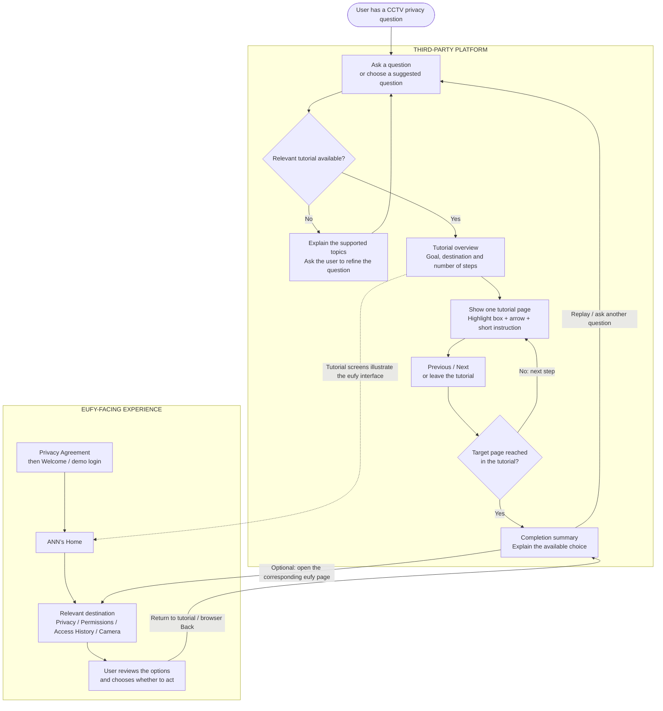
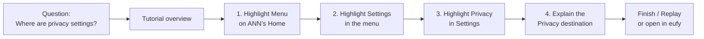
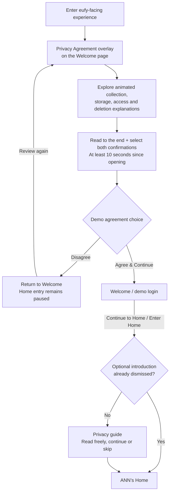
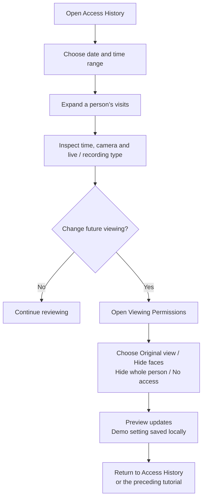
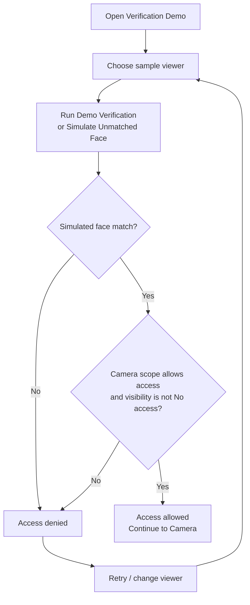

# CCTV Privacy Prototype — Workflow

**Updated:** 26 October 2026  
**Project:** DECO7380 CCTV Privacy Prototype  
**Purpose:** One reference file for the complete user workflow, including the third-party tutorial platform and the proposed improvements to the eufy experience.

## 1. What the prototype does

A user asks a CCTV privacy question. The third-party platform finds the relevant tutorial and guides the user through the interface **one step at a time**. Each tutorial page shows the relevant interface, draws a box around the target control, uses an arrow to point to it, and explains the next action in plain English.

The core experience is **question → guided tutorial → find the setting → make an informed choice**. A written answer or link can support the tutorial, but does not replace the step-by-step guidance.

The eufy-facing part contains the welcome/login experience, animated agreement, camera screens, privacy settings, viewing permissions and access history. This is a proposed collaborative improvement to eufy, not an existing commercial partnership.

## 2. Product boundaries

| Third-party platform | eufy-facing experience |
| --- | --- |
| Search / query entry | Privacy Agreement and animated explanation |
| Matching the question to a tutorial | Welcome / demo login |
| Tutorial pages with highlighted boxes, arrows and instructions | ANN’s Home, menu and Settings |
| Previous / Next / Replay and tutorial completion | Privacy guide and basic privacy information |
| Privacy Profile, data-flow and evidence explanations | Viewing Permissions and camera previews |
| Finding the relevant action and explaining its consequences | Viewer verification demo, Events and Access History |

**Welcome / login belongs to the eufy-facing experience.** Search and the tutorial guide belong to the third-party platform. A tutorial explains how to reach a control; it does not silently accept an agreement or change that control for the user.

## 3. Overall workflow

The tutorial can teach navigation without changing settings. Opening the corresponding eufy destination is an explicit handoff. Reading guidance and completing a tutorial do not prove that a setting was changed in a real account.

## 4. Main tutorial: “Where can I find my privacy settings?”

**Entry question:** “Where are the privacy settings?”  
**Tutorial goal:** Help the user locate Privacy in the eufy interface.  
**Destination:** Menu → Settings → Privacy.

| Page | Interface shown | Box and arrow target | Instruction shown to the user | Navigation |
| --- | --- | --- | --- | --- |
| Overview | Tutorial title and destination | No interface target yet | “Let’s find your privacy settings in eufy.” | Start tutorial / Back to search |
| Step 1 | ANN’s Home | Menu icon at the top left | “Open the menu.” | Next / Exit |
| Step 2 | Open account menu | Settings item | “Choose Settings.” | Previous / Next / Exit |
| Step 3 | Settings page | Privacy row | “Open Privacy.” | Previous / Next / Exit |
| Step 4 | Privacy guide | The three privacy entry cards | “You’ve found Privacy. Choose what you want to understand.” | Previous / Finish |
| Completion | Short summary of the route | Optional link to the destination | “You can return here through Menu → Settings → Privacy.” | Replay / Ask another question / Open in eufy |

The highlighted control changes on every page. Only the current step’s target is emphasised. Previous returns to the preceding instruction; Exit returns to search. Tutorial screens should make clear whether the user is practising in an illustration or acting in the connected prototype.

## 5. Tutorial page behaviour

Every tutorial should use the same structure:

1. **Goal and progress:** tutorial title and “Step X of Y”. This is tutorial navigation, not a consent-completion score.
2. **Interface context:** show the screen needed for that step, preserving the eufy UI.
3. **Visual target:** draw a clear box around the relevant control and point to it with an arrow. Avoid covering the control’s label.
4. **One instruction:** explain what to select and, when useful, why.
5. **Navigation:** Previous, Next and Exit; Replay and Ask another question at the end.
6. **Action boundary:** distinguish an instructional example from an actual permission change. Never describe a setting as saved unless the connected prototype confirms it.

For the current workflow specification, Next advances the tutorial page. Whether clicking the highlighted control also advances the tutorial is an implementation choice to confirm when building it. The workflow does not assume automatic detection of actions in a real eufy app.

## 6. Additional tutorial workflows

| User’s question / goal | Guided sequence | End point and explanation |
| --- | --- | --- |
| “Who can see my camera?” | Find Access History → identify a person → open Viewing Permissions | Distinguish current permission from historical visits |
| “How do I stop Emma seeing my camera?” | Open Emma’s Viewing Permissions → explain the four visibility options → highlight No access | User chooses whether to change the setting; affects future simulated access |
| “Who accessed my camera yesterday?” | Open Events → Access History → date/calendar → select the relevant date → expand a person | Show time, camera and live-video/recording visit type |
| “Where are my videos stored?” | Open Privacy → Your data journey → inspect Camera, microSD and App nodes → explore optional cloud/HomeBase explanation | Explain an example storage path; do not claim to detect real storage |
| “What happens if I download or delete a recording?” | Open Privacy → Keep, share or delete → follow the copy diagram → inspect deletion guidance | Local footage, cloud backup and exported files are separate copies |
| “How does face verification work?” | Open Privacy → People & access → Try the Verification Demo → choose a sample viewer → run the demo | Explain that identity matching and camera permission are separate checks |
| “What do these privacy scores mean?” | Privacy Profile → Exposure / User Control → inspect factors → Evidence & scoring | Scores are illustrative research examples, not live security ratings |
| “Where can I review the agreement?” | Third-party agreement guidance → explicitly open eufy Privacy Agreement | Explore collection, storage, access and deletion before demo entry |

These sequences form the tutorial content plan. They should use verified screenshots or the current prototype UI when implemented; they are not a claim that every guided overlay already exists.

## 7. eufy agreement and welcome/login workflow

The agreement is displayed as an overlay on the welcome page, before entry to Home. It belongs to the eufy-facing part of the project.

Before **Agree & Continue** becomes enabled, the user must (1) reach the bottom of the agreement, (2) select both reading confirmations, and (3) wait at least 10 seconds from opening the agreement. A “Select all” checkbox above the two items selects or clears both together; it never enables optional cloud recording. It shows a mixed state when only one confirmation is selected. These conditions are independent: the timer alone does not unlock the button. Reopening the agreement resets the timer, reading position and confirmation selections. Optional cloud recording can remain off. Scrolling to the bottom is an interface check, not proof of comprehension. Three coloured “Key point” questions encourage users to explore storage, viewer access and separate copies. Storage and access use light teal; deletion/copies use light amber. Opening these explanations is optional and is not an additional condition for continuing.

The agreement includes animation controls, expandable explanations and an optional cloud illustration. No real cloud upload occurs. The welcome form does not authenticate a real account; real credentials are unnecessary. Agreement acknowledgement is demonstration state, not production legal consent.

The optional guide after Home entry is separate from the agreement. Continue and Skip close that guide without accepting terms or changing permissions. Existing targeted prototype links can bypass the general agreement/welcome route; they should not be drawn as always passing through login.

## 8. eufy privacy content

| Entry | What the user explores | Related tutorial destination |
| --- | --- | --- |
| Your data journey | Collection, transmission, example local storage, viewing, optional cloud/HomeBase and notification-preview paths | Understanding storage and finding privacy information |
| People & access | Owner/shared-viewer scope, camera access and viewer verification | Who can view; how to review access; verification explanation |
| Keep, share or delete | Retention factors and separate local, cloud and exported copies | Understanding download, sharing and deletion consequences |
| Privacy settings & policies | Official documents, app-permission explanations and data rights | Finding policies and distinguishing demo state from real product data |

The three knowledge entries are optional and can be read in any order. They are not a mandatory agreement checklist.

## 9. eufy access review and control workflow

A past “Allowed at visit” event is different from current permission. Changing permission does not rewrite historical visits or erase downloaded copies. Visibility is currently selected per demonstrated member/camera; separate live-versus-recording permission switches are not implemented.

The demo’s reference today is 21 October 2026, so its example “yesterday” is 20 October. Current search links do not automatically select that calendar date. The tutorial should explain the date selection explicitly.

## 10. Viewer verification workflow

Verification concerns the **viewer**, not people captured in footage. The demo does not activate a camera or collect face biometrics. Direct camera routes currently open an illustrated preview without requiring the verifier, so this is not enforced authentication across the whole prototype.

## 11. Whole-repository coverage

All modules in the GitHub repository belong to the project, including feature-branch work. The workflow includes their user-facing role without assuming that everything has already been merged or published.

| Module / feature | Role in the complete prototype |
| --- | --- |
| Third-party search and answers | Entry question, topic matching and the starting point for the guided tutorial |
| Privacy Profile | Device/scenario overview and routes to explanations |
| Exposure, User Control, Evidence & scoring | Explain fixed example ratings and their limitations |
| Interactive Data Flow | Explain local, optional cloud and exported-copy paths |
| Access-review overview | Introduce activity and link to detailed Access History |
| Agreement and welcome/login | eufy-facing onboarding and animated privacy explanation |
| Home and camera routes | eufy-facing device context and illustrated previews |
| Events, Access History and Viewing Permissions | Review visits and choose future visibility |
| Face verification | Simulate viewer identity and permission decisions |
| Settings, privacy guide and policies | Revisit information and locate privacy content |
| Messages and Notifications | Explain demo messages and saved notification preferences |
| Services, Smart and Shop | Supporting eufy interface context, including product routes where present |
| Add Device, Favorites, QR and contextual dialogs | Context interactions; not completed hardware setup or checkout |
| SVG illustrations, tests and documentation | Supporting assets/evidence, not additional user screens |

## 12. Current implementation versus tutorial design

**Source snapshots inspected:** `main` at `2bb1fe2`; `feat/privacy-search-entry` at `43b4c99`. These are the evidence snapshots for this file, rather than a promise that future repository versions behave identically.

| Item | Observed status | Workflow treatment |
| --- | --- | --- |
| Search, structured answers, profile and linked actions | Implemented on the search feature branch | Included as part of the third-party platform |
| One-page-at-a-time tutorial with boxes and arrows | Defined by the team in this workflow; not found in the inspected search implementation | Core intended user journey to implement |
| Agreement, welcome and eufy-facing screens | Present on main | Included as the collaboration/improvement side |
| Third-party root entry on current main | Not merged; main root redirects to agreement | Combined workflow includes both modules; publication is separate |
| Face-verification results in Access History | Audit helpers exist, but current History rendering reads seeded visit data without the verification panel | Do not claim generated verification results appear there automatically |
| Owner identity | Shell displays ANN; some sample people/verifier data still say Alex | Use ANN’s Home for navigation; align sample identities during integration |
| Example privacy scores | Fixed Exposure 5/10 and User Control 8/10 | Explain as research examples, not measured account status |

## 13. Tutorial implementation priorities

1. Build the first complete tutorial: **“Where are my privacy settings?”** using Home → Menu → Settings → Privacy.
2. Add the shared tutorial structure: overview, one target per page, box, arrow, brief instruction, Previous, Next, Exit and completion.
3. Add tutorials for Access History and Viewing Permissions, including the effect of No access on future viewing.
4. Add storage/copies and agreement tutorials using the existing animated privacy explanations.
5. Connect explicit “Open in eufy” destinations and retain a clear way to return to the tutorial.
6. Check desktop/mobile target placement, keyboard navigation, readable instructions and behaviour when a question has no matching tutorial.
7. Align published entry points, sample identity labels and verification/history connections before presenting the combined experience as fully integrated.

## 14. Example end-to-end demonstration

1. The user opens the **third-party platform** and asks, “Where are my privacy settings?”.
2. The platform offers the matching tutorial and states the goal.
3. Page 1 highlights the menu icon on ANN’s Home with a box and arrow.
4. Page 2 highlights Settings in the opened menu.
5. Page 3 highlights Privacy in Settings.
6. Page 4 explains the Privacy destination and its three knowledge entries.
7. The user finishes, replays, asks another question, or explicitly opens the corresponding eufy page.
8. If the user asks how to stop a shared viewer, a new tutorial explains how to find Viewing Permissions and what No access means.
9. Any actual demo permission change occurs on the eufy-facing control page. Tutorial completion alone changes no permissions.
10. The user returns to the third-party platform for further guidance or reviews Access History in eufy.

## Source references

- [Third-party search implementation](https://github.com/yenyong1211/DECO7380_CCTV/tree/43b4c99e6082f11dd4e5bf87ef442b8fa1691c30/privacy)
- [Third-party entry page](https://github.com/yenyong1211/DECO7380_CCTV/blob/43b4c99e6082f11dd4e5bf87ef442b8fa1691c30/index.html)
- [Agreement and welcome](https://github.com/yenyong1211/DECO7380_CCTV/tree/2bb1fe2fd5a3a8035428e4d0d8e4a4ac5bf38cdf/agreement)
- [eufy-facing routes and permission controls](https://github.com/yenyong1211/DECO7380_CCTV/blob/2bb1fe2fd5a3a8035428e4d0d8e4a4ac5bf38cdf/prototype/history/history.js)
- [Viewer verification](https://github.com/yenyong1211/DECO7380_CCTV/blob/2bb1fe2fd5a3a8035428e4d0d8e4a4ac5bf38cdf/prototype/auth.js)

This file specifies the workflow. Creating or updating it does not modify the application UI, merge branches or publish tutorial features.
